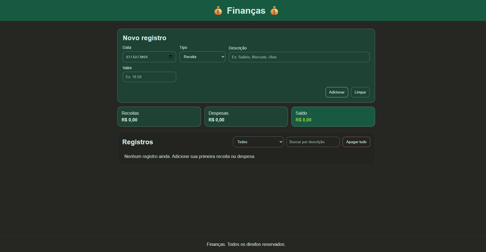
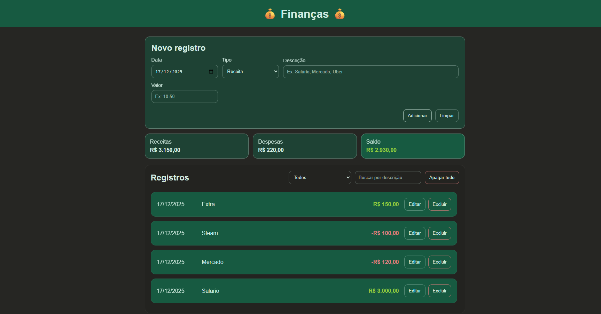

<h1><strong>Finance Manager</strong></h1>

<h2><strong>Descrição</strong></h2>

  Aplicação web para controle financeiro pessoal, com registro de receitas e despesas, cálculo automático de totais e saldo, além de persistência de dados no navegador via localStorage.

<h2><strong>Funcionalidades</strong></h2>
<ul>
  <li align="justify">Adicionar registros com <strong>data</strong>, <strong>tipo</strong> (receita ou despesa), <strong>descrição</strong> e <strong>valor</strong>.</li>
  <li align="justify">Listar registros de forma organizada, com destaque visual para receitas e despesas.</li>
  <li align="justify">Editar registros existentes por meio de um modal de edição.</li>
  <li align="justify">Excluir registros individualmente.</li>
  <li align="justify">Apagar todos os registros com confirmação.</li>
  <li align="justify">Filtrar por tipo (todos, receitas, despesas) e buscar por descrição.</li>
  <li align="justify">Resumo automático: <strong>total de receitas</strong>, <strong>total de despesas</strong> e <strong>saldo</strong>.</li>
  <li align="justify">Persistência de dados com <strong>localStorage</strong>, mantendo as informações mesmo após fechar o navegador.</li>
</ul>

<h2><strong>Demonstração do Projeto</strong></h2>

  
  
   
  <a href="https://github.com/williandpg/gerenciador-de-financas" target="_blank"><strong>Acesse o repositório do projeto</strong></a>

<h2><strong>Tecnologias Utilizadas</strong></h2>
<ul>
  <li align="justify"><a href="https://developer.mozilla.org/pt-BR/docs/Web/HTML" target="_blank"><strong>HTML</strong></a>: Estruturação da interface e semântica da página.</li>
  <li align="justify"><a href="https://developer.mozilla.org/pt-BR/docs/Web/CSS" target="_blank"><strong>CSS</strong></a>: Estilização, layout responsivo e componentes visuais.</li>
  <li align="justify"><a href="https://developer.mozilla.org/pt-BR/docs/Web/JavaScript" target="_blank"><strong>JavaScript</strong></a>: Lógica do app, manipulação do DOM, filtros, CRUD e persistência de dados.</li>
  <li align="justify"><a href="https://developer.mozilla.org/pt-BR/docs/Web/API/Window/localStorage" target="_blank"><strong>localStorage</strong></a>: Armazenamento local dos registros no navegador.</li>
</ul>

<h2><strong>Estrutura do Projeto</strong></h2>

A estrutura do projeto é organizada da seguinte forma:

<pre><code>
/
├── index.html
├── style.css
├── script.js
├── assets/
│   ├── preview-1.png
│   └── preview-2.png
└── README.md
</code></pre>

<h2><strong>Contato</strong></h2>

  <strong>Willian Gonçalves</strong> |
  <a href="https://www.linkedin.com/in/williandpg/" target="_blank"><strong>LinkedIn</strong></a> |
  <a href="https://github.com/williandpg" target="_blank"><strong>Github</strong></a> |
  <a href="https://williandpg.github.io/" target="_blank"><strong>Portfólio</strong></a> |
  <a href="mailto:goncalves.wdp@outlook.com" target="_blank"><strong>Email</strong></a>

<h2><strong>Créditos</strong></h2>

  Projeto desenvolvido durante uma mentoria no curso de Desenvolvimento Web Full Stack da Trybe.

  
<strong>English Version</strong>

  <h1><strong>Finance Manager</strong></h1>

  <h2><strong>Description</strong></h2>
  

    A web application for personal finance tracking, allowing users to register income and expenses, automatically calculate totals and balance, and persist data in the browser using localStorage.
  

  <h2><strong>Features</strong></h2>
  <ul>
    <li align="justify">Create entries with <strong>date</strong>, <strong>type</strong> (income or expense), <strong>description</strong>, and <strong>amount</strong>.</li>
    <li align="justify">Dynamic list rendering with visual highlighting for income and expenses.</li>
    <li align="justify">Edit entries through an edit modal.</li>
    <li align="justify">Delete single entries.</li>
    <li align="justify">Delete all entries with confirmation.</li>
    <li align="justify">Filter by type and search by description.</li>
    <li align="justify">Automatic summary: <strong>total income</strong>, <strong>total expenses</strong>, and <strong>balance</strong>.</li>
    <li align="justify">Data persistence via <strong>localStorage</strong>.</li>
  </ul>

  <h2><strong>Project Demonstration</strong></h2>
  

    
    
     
    <a href="https://github.com/williandpg/gerenciador-de-financas" target="_blank"><strong>Access the repository</strong></a>
  

  <h2><strong>Technologies Used</strong></h2>
  <ul>
    <li align="justify"><a href="https://developer.mozilla.org/en-US/docs/Web/HTML" target="_blank"><strong>HTML</strong></a>: Page structure and semantics.</li>
    <li align="justify"><a href="https://developer.mozilla.org/en-US/docs/Web/CSS" target="_blank"><strong>CSS</strong></a>: Styling, responsive layout, and UI components.</li>
    <li align="justify"><a href="https://developer.mozilla.org/en-US/docs/Web/JavaScript" target="_blank"><strong>JavaScript</strong></a>: App logic, DOM manipulation, filters, CRUD operations, and persistence.</li>
    <li align="justify"><a href="https://developer.mozilla.org/en-US/docs/Web/API/Window/localStorage" target="_blank"><strong>localStorage</strong></a>: Local browser storage for entries.</li>
  </ul>

  <h2><strong>Project Structure</strong></h2>
  
The project structure is organized as follows:

  <pre><code>
  /
  ├── index.html
  ├── style.css
  ├── script.js
  ├── assets/
  │   ├── preview-1.png
  │   └── preview-2.png
  └── README.md
  </code></pre>

  <h2><strong>Contact</strong></h2>
  

    <strong>Willian Gonçalves</strong> |
    <a href="https://www.linkedin.com/in/williandpg/" target="_blank"><strong>LinkedIn</strong></a> |
    <a href="https://github.com/williandpg" target="_blank"><strong>Github</strong></a> |
    <a href="https://williandpg.github.io/" target="_blank"><strong>Portfolio</strong></a> |
    <a href="mailto:goncalves.wdp@outlook.com" target="_blank"><strong>Email</strong></a>
  

  <h2><strong>Credits</strong></h2>
  

    This project was developed during a mentorship as part of the Trybe Full Stack Web Development course.
  

